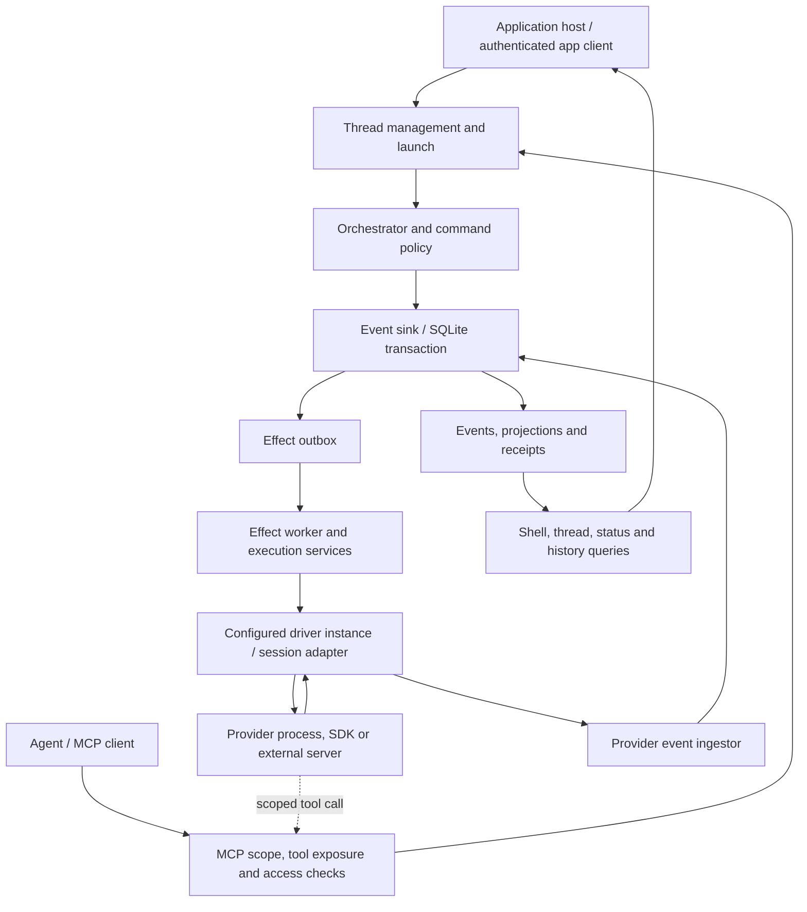

# How T3 Code orchestrates agents

This analysis follows the server implementation at [`338352d`](https://github.com/pingdotgg/t3code/tree/338352dee2f43079482e054e8229a2ba055641d9). Source and test inspection establish the baseline. Live harness behavior, platform support and installability of an extracted package still require execution. The [package overview](../README.md) presents the proposed API. The [inventory](parity-inventory.md) indexes wire names.

## The extraction boundary

Start at **`ThreadManagementService`** for actions an application would perform, **`OrchestratorV2`** for command decisions and **`runtimeLayer.ts`** for the services those decisions actually need. The first gives WS and MCP callers shared operations such as sending to a thread. Launch has additional work for checkout selection, preparation and bootstrap. The orchestrator needs a running effect worker, projection store and provider registry to turn a successful command into an executing agent. Upstream distributes its server as a CLI. Several providers already have workspace packages, but the command processor and even three production adapters still live under the server app. [Management][src-1] · [Launch][src-2] · [Composition][src-3] · [Current distribution][src-4]

### Where to cut the server dependency

| Upstream entry point | What to carry into an embedded host |
| --- | --- |
| `orchestration-v2/runtimeLayer.ts` → `layer` | The command processor, management service, session manager, event and output services, worker and recovery share one Effect resource scope. Reuse the same event sink and viewer registry for reads and writes. This layer already takes dependencies on MCP App context and preview activity during run execution. A minimal host needs an implementation for the no-app or no-preview case. [Runtime composition][src-3] |
| `orchestration-v2/runtimeLayer.ts` → `layerProduction` | This layer adds thread launch, managed folders, worktree sync, schedules, guests, secrets, continuation and usage-limit workers, imports, cleanup and pruning. Move root-workspace launch into the first SDK milestone. Add the remaining workers alongside the features whose state they maintain. [Runtime composition][src-3] |
| `provider-core/server/ProviderHost` → `ProviderHostLive` | The provider packages already depend on a host interface. Implement it for the SDK using explicit paths, settings snapshots and subscriptions, credential bindings, background policy, compatibility lookup and attachment resolution. The server's implementation shows which readiness and port-discovery hooks are optional. [Host interface][src-55] · [Server implementation][src-83] |
| `apps/server/src/server.ts` | Read the production wiring here to find dependencies still supplied from outside the orchestration directory. Trace the resource owner of each one. The SDK's `open` must acquire those required by its profile, share them with the transports and release them on `close`, even when startup fails partway. [Server assembly][src-105] |

### Follow one message end to end

1. The host resolves a project, cwd/worktree and model selection. Launch can create an empty thread. With a first message, preparation can create work before a provider turn starts. An agent-originated send first resolves the live caller and target, enforces mode ceilings and records the sender identity. A scoped stable request key yields stable operation IDs. [Launch][src-2] · [Message intake][src-5] · [Agent send][src-6]
2. The orchestrator serializes commands for the thread, checks receipts and chooses the dispatch mode using current projected state and provider capabilities. Active compaction, incompatible attachments, a queued run or an unavailable steering path can change delivery. Deletion takes a separate lock before thread locks so concurrent deletes can determine what living forks need. [Command executor][src-7] · [Command policy][src-8] · [Receipts and races][src-9]
3. The event sink writes the domain events, projection changes, receipt and requested side effects in a transaction. Subscribers see committed changes. The receipt contains a result sequence. A host that needs the model's answer must observe the run through completion. [Transaction and publication][src-10] · [Receipt schema][src-11]
4. The worker claims an effect. Starting a turn involves opening or resuming the appropriate provider session, issuing scoped tool access, establishing its event subscription and sending the prompt with attachments, instructions and pending context. Provider sessions, turns and their callbacks have lifetimes of their own. [Worker][src-12] · [Session manager][src-13] · [Turn start][src-14]
5. The adapter maps provider frames to application facts. The ingestor and projectors correlate provider activity with the run, attempt and execution node. A client can see assistant text, tools, reasoning, plans, requests, child work and outcomes as the harness emits them. A high-volume stream can be coalesced. A separate output tail serves clients viewing a running command. [Adapter interface][src-15] · [Ingestor][src-16] · [Commit batching][src-17] · [Output hub][src-18]
6. Finalization updates the run and determines what follows. A child result, background wake, queued user message, pending approval or usage-limit reset can cause a different next action. The shell is the cheap overview. The thread projection and paged activity supply the details. [Finalization][src-19] · [Mailbox][src-20] · [Limit recovery][src-21] · [Read model][src-22]

## Which identity or status to expose

| Identity | Lifetime and question it answers |
| --- | --- |
| Environment / project / checkout | Which machine and project own this address? Which directory will actions affect? Several threads can share a checkout. A linked environment has its own IDs and access policy. |
| App thread / message | Where do I send another instruction? Which message did the engine accept? A thread can survive provider switches, contain multiple runs or have no run yet. |
| Run / run attempt | Which unit of requested work am I watching? Which execution produced this outcome? A restarted attempt or a continuation can involve another native turn. |
| Execution node / native subagent / delegated task | Which branch of work owns an item or request? A delegated task has a parent-controlled ID and child address. A provider-native child can be visible without being independently addressable. |
| Driver kind / instance / continuation identity | Which implementation, configuration and provider history can execute this work? Two instances of a driver may use different accounts or homes. Reuse depends on continuation identity. |
| Provider session / thread / turn / native ref | Which provider conversation can resume or accept a callback? T3 IDs correlate facts even where native IDs have `strong`, `weak` or `none` quality. |
| Turn item / request / checkpoint scope / handoff / transfer | Which activity can be paged, answered, restored or delivered? Transfers record source and target, delivery progress and provenance. A Git checkpoint adds a workspace ownership boundary. |

The run status union is `preparing`, `queued`, `starting`, `running`, `waiting`, `completed`, `interrupted`, `failed`, `cancelled` and `rolled_back`. A thread read can also report `idle`. Expose the run ID with its status. A provider's health describes whether an instance can run work. Sidebar settlement describes how to present the thread. A delegated task's `workState` describes whether its result is available, including outstanding children. A practical status view also needs the oldest blocking question or approval and the latest terminal result. [Domain contracts][src-23] · [MCP results][src-24] · [Completion reads][src-25] · [Provider driver][src-26]

## Three ways agents collaborate

| Mechanism | Creation and address | How a result reaches the caller |
| --- | --- | --- |
| Independent agent threads | The host launches threads. A live agent can use `create_threads` for 1–20 ordinary local threads inheriting checkout context, optionally with initial prompts. Creation provenance records who made them. `t3_thread_launch` supports single-thread launch and worktree setup. | An agent sends to a thread ID with `t3_thread_send`. The recipient can send a reply using the recorded origin. Each send returns its own delivery and run. Clients read or wait for the desired run. |
| T3-owned delegated tasks | A live, scoped parent calls `delegate_task` with a task, optional role, target instance/model/options, modes and shared/worktree isolation. The child receives that assignment. A remote target creates an ordinary remote thread with a local durable task follower. | The task carries a result transfer and a completion-delivery record. The parent can be woken after its turn ends. A status read or a read of the final child answer can acknowledge delivery. Follow-ups can produce a later terminal result while retaining the original task result. |
| Provider-native children | The model uses the harness's own subagent or workflow facility. Its adapter projects native lifecycle, ancestry, outputs, pending requests and background work where available. | The harness governs native result delivery. The app may observe or stop a child, and some harnesses expose a forkable native thread. Check the actual capability and identity before showing these controls. |

For direct messaging, preserve requested `auto`, `queue`, `steer` or `restart` and return actual `started`, `queued`, `steered` or `restarted`. `freshContext` starts fresh provider context. Every peer message must retain its origin, including a remote origin. A single thread list plus recursive retries cannot reproduce the routing, delivery receipts or follow-up ownership. [Tool service][src-6] · [Management][src-1] · [MCP schemas][src-24]

For delegation, persist the child address, task ID, original and latest terminal runs, pending questions/approvals, result transfer and wake policy. A local child can exist before it has a run. A remote result can have a null local child thread ID and carry `remoteChild`. Async work can outlive the originating turn. A synchronous wait is capped at 45 seconds and can return early for human input. `task_cancel` applies to running and queued work, descendants, later work in the same child and its watches. A finished task retains its result. A thread-wide Stop also holds the queue. An interrupt aimed at one run has narrower effects. [Delegation tools][src-27] · [Completion delivery cases][src-28] · [Remote orchestration][src-29] · [Stop cases][src-30]

## Provider support at the pinned revision

The registry wires **11 driver kinds**. Eight live in dedicated provider packages. Codex, Claude and Antigravity still have server-local drivers and adapters. The registry separately orders eight usage readers, keeping the first duplicate usage record. fx, Kiro and ACP Registry have no entry in that aggregate. Provider-reported usage within a run is a separate capability. [Built-in driver and usage order][src-31]

| Driver kind | Runtime and extraction details | Evidence |
| --- | --- | --- |
| `codex` | JSON-RPC app-server. Preserve native fork, prior-turn boundaries, rollback, goals, subagent threads, approvals, developer instructions, native history injection where supported, and managed vs local auth/home paths. | [Adapter][src-32] · [Driver][src-33] |
| `claudeAgent` | Agent SDK query stream. Preserve live tool callbacks, native fork/rollback, background tasks, nested agents and workflows that can wake an idle parent. A stored approval can lose its native callback on process loss. | [Adapter][src-34] · [Driver][src-35] |
| `cursor` | Cursor SDK. Rollback and active steering are available. Steering takes text and can interrupt tools. Native fork is unavailable. Carry the SDK patch, executable/native assets and platform tests into the distribution audit. | [Adapter][src-36] · [SDK patches][src-37] |
| `grok` | ACP with Grok-specific steering, native child lineage and background command/monitor wakes. Test blocked commands and prompt errors. The implemented adapter advertises active steering. | [Adapter][src-38] · [Replay coverage][src-39] |
| `fx` | ACP with backend/model selection per session, child lifecycle and shared machine login. Preserve early-stop behavior and propagation of child stop. Treat login sharing as a driver constraint when configuring instances. | [Adapter][src-40] · [Provider guide][src-41] |
| `opencode` | One driver, two implementation paths. Managed 1.x runs a per-thread chat process. Managed 2.x shares a server per instance and registers MCP by directory with per-thread credentials/rules. The 2.x static MCP flag is false despite this managed registration path. External-server mode skips endpoint registration. Qualify both majors and both ownership modes. | [1.x adapter][src-42] · [2.x adapter][src-43] · [Provider guide][src-44] |
| `antigravity` | Server-local ACP variant with profile, install and authentication behavior plus native child updates. It has adapter tests but no entry in the shared orchestration replay runner at this commit. Add a recorded end-to-end scenario before claiming the same replay coverage as the other ten drivers. | [Adapter][src-45] · [Driver][src-46] · [Replay registry][src-102] |
| `kiro` | ACP variant with native prior-turn fork, active steering, compaction, model/effort configuration, permission modes and subagent interruption. Negotiated config can change which selection applies. | [Adapter][src-47] · [Replay coverage][src-48] |
| `pi` | RPC process and native session files for fork, rewind and resume. A private extension bridges scoped MCP into Pi. Child results can be visible with no addressable provider child thread. Package the extension source and test its launch from the installed module. | [Adapter][src-49] · [MCP extension][src-50] |
| `muse` | MSP/SDK. Preserve workflow progress, child approval and stop, active steering and live callbacks. Native fork and native conversation rollback are unavailable. Higher-level portable operations have separate eligibility. | [Adapter][src-51] · [Replay coverage][src-52] |
| `acpRegistry` | Generic ACP driver for configured registry agents. Shared ACP handles initialization, streams, session negotiation and replay-based rollback. Per-agent configuration and quirks change behavior. Test a representative registry agent and feature-denied paths. | [Registry adapter][src-53] · [Shared ACP][src-54] |

**Keep the driver and session adapter as two interfaces.** The driver declares metadata, configuration codec/defaults and instance construction. A configured instance provides snapshots, cwd-sensitive models/options/skills, refresh, health, auth/maintenance and text generation as supported. Its continuation key governs whether persisted sessions can resume. The session adapter owns a scoped event stream, thread creation/resume, turn start/steer/interrupt, runtime answers, snapshots, fork and rollback. Optional hooks include history injection, compaction, native resume, model/title updates, stop/wait for background work and MCP Apps. Keep install detection, release/compatibility checks and authentication in the application experience. [Driver shape][src-26] · [Adapter shape][src-15] · [Host dependencies][src-55] · [Instance hydration][src-56]

A capability query should expose the instance's usable operations, constraints and evidence of availability. The schema covers **sessions, threads, turns, streaming, tools, approvals, planning, subagents, context, checkpointing, identity and runtime policy**. Combine the static declarations with the installed version, server ownership, handshake, cwd, model and live state. The selection policy can apply an option on the next turn, restart the session, create a handoff or reject the change. Preserve differences such as text-only steering and live-only approval callbacks. [Capability schemas][src-23] · [Selection transitions][src-57] · [MCP capability discovery][src-24]

For shared ACP, inspect the capabilities again after initialization. The agent's `loadSession` enables thread and checkpoint conversation snapshots. A negotiated fork enables native fork, and prior-turn fork additionally requires support from the ACP flavor. Session setup or a known late-arriving model option can enable in-session model switching. A flavor that negotiates prompt-based steering can add active steering to the base declaration. The shared adapter marks MCP support available at this stage and selects the transport its flavor can use. Actual tools still depend on the session credential and host. [ACP negotiation and MCP transport][src-54]

## Recovery, streams and context

**Recovery has a boundary at external I/O.** One transaction can deduplicate a command and commit its effects. A process can still die after delivering a prompt and before recording its outcome. T3 classifies effects as replay-safe or bound to the lost process. Recovery reconciles sessions, attempts and pending requests, resumes or interrupts as supported, and recovers orphaned or outstanding delegated work. Startup imports legacy shells, reconciles the process and delegates, starts the worker with relay coordination, bootstraps and opens the command gate. Shutdown closes admission, interrupts the worker and reconciles. Preserve this ordering in an embedded `open`/`close` lifecycle. [Effect classifications][src-58] · [Recovery][src-59] · [Startup and shutdown][src-60]

**The database is more than an event log.** Keep projections, sequence high-water marks, receipts and outbox state in migrations. Pruning keeps a bounded recent replay window and selected dependency anchors. A consumer with an expired cursor must recover from a snapshot. An old accepted command can still deduplicate by its receipt after its event goes away. Shell and thread subscriptions have separate snapshot/replay budgets and coalescing. Preserve HTTP snapshot/history paging alongside streaming reads for large threads. Treat live command output and prompt suggestions as ephemeral feeds. [Retention][src-61] · [Shell stream][src-62] · [Thread stream][src-63] · [HTTP reads][src-64] · [Client state][src-65]

**Context crosses providers through explicit transfers.** Prefer an eligible native fork at a stable source point. A portable fork or switch selects bounded history, preserves role and ordering, carries references for omitted activity, and keeps the current user request separate. Portable history excludes native tool state, provider reasoning and attachments. The target can receive native injected history or attributed inline context. Delivery records protect against repeating a handoff after an ambiguous injection. Merge-back delivers context from related threads, independently of any Git merge. [Fork policy][src-8] · [Portable handoff behavior][src-66] · [Delivery and budgeting][src-67] · [Merge-back test][src-68]

**Rewinding has two dimensions.** At an eligible checkpoint, a provider may truncate natively or reconstruct the retained conversation in a fresh session using a snapshot. File restoration additionally needs a valid checkpoint scope, correct checkout ownership and restore safety checks. Expose this distinction in the command and its error. Use real temporary Git repositories to test dirty files, sibling threads sharing a checkout, forks and mismatched scopes. [Rollback policy][src-8] · [Rollback service][src-69] · [Restore safety tests][src-70]

**Existing conversations enter through three paths.** V1 migration copies `state.sqlite` to `statev2.sqlite`, migrates the copy, imports shells, then lazily imports ordered user/assistant messages. Its first continuation uses a bounded legacy handoff. Tool activity, approvals, checkpoints and native sessions cannot be reconstructed from that transcript. The project-level `agentSessions.scan` and `agentSessions.import` read external transcripts for exactly `claudeAgent`, `codex` and `pi`. The separate `server.importAcpRegistrySession` operation uses the selected registry instance and project to import a native session. Test all three paths, including repeated imports and source identity checks. [Migration scope][src-71] · [Cutover][src-72] · [Transcript sources][src-103] · [Scanner][src-73] · [Importer][src-74] · [Registry RPC handler][src-104]

## Host services that determine full parity

| Service to extract or adapt | What the application has to provide or enable | Source |
| --- | --- | --- |
| Data and ownership | Writable private state directory, migrations, receipts, SQLite worker lifetime, attachment blobs and references, process ownership and cleanup. Use one runtime owner per state directory for the first release. | [SQLite][src-75] · [Ownership][src-76] · [Attachments][src-77] |
| Workspaces and projects | Workspace roots, optional Git and worktree locations, branch/ref semantics, setup scripts, prepared-run progress, clone/scratch promotion and cleanup. Expose workspace failures to the launching caller. | [Project services][src-78] · [Checkpoint services][src-79] · [Thread launch][src-2] |
| Human and agent access | Authenticate the host user/client. Surface approval, question, permission, secret and link cards. Keep private replies out of prompts/logs except as the original delivery contract directs. Support expiry, cancellation, one-use references and unavailable callbacks. | [Request delivery][src-80] · [MCP access][src-81] · [Secret handling][src-82] |
| Provider configuration | Resolve paths, per-instance environment variables and secret references, host credentials, CLI discovery and installs, model manifest, native event diagnostics, model selection, usage aggregation and limit reset/resume. | [Provider host][src-83] · [Provider setup contracts][src-84] · [Usage][src-85] |
| Remote environments and guests | Stable environment identity, authenticated transport, pairing/link approval and limits, forwarded origins, durable remote follower and connection lifecycle. Hosted T3 Connect/relay, guest URLs and webhook ingress require a compatible service or an application implementation. | [Peer services][src-86] · [Relay][src-87] · [Guest sharing][src-88] |
| Schedules and webhooks | Persistent task store, clock/timezone, scheduler, inbound route, signature/filter/deduplication, run history and explicit run permission. Support interval, fixed-time, one-shot and webhook schedules with new-thread, continue and fresh-session behavior. | [Schedule contracts][src-89] · [Scheduler and webhook tests][src-90] |
| Repository workflows | VCS driver and configured source-control/issue-tracker integrations, account credentials and project bindings. Preserve PR links/stacks, checks, CI log queries, reviews, watches, feedback and wakes as exposed. | [Source control][src-91] · [Issues][src-92] · [Watch reactor][src-93] |
| Interactive tools and clients | Provide terminal/process, preview/browser, device and HTML rendering hosts, attachment transfer, user messaging and MCP App tools/resources. Expose only usable tools. A headless host can implement these ports or report them unavailable. | [Toolkits][src-94] · [MCP Apps][src-95] · [Terminal][src-96] · [Devices][src-97] |

The trusted host, a provider acting as one thread, a guest, and an outside OAuth client have different authority. Issue scoped MCP credentials before the provider needs them. Bind environment, thread, provider session and instance, and preserve revocation/expiry. Re-evaluate live ownership and operation-specific read/write policy at invocation. `approval-required`, `auto-accept-edits`, `auto` and `full-access` are runtime modes. `default` and `plan` are interaction modes. Linked writes also obey the remote grant. `t3_pending_request` handles user questions and their answers. Human approval needs an authorized responder. Forwarded operations must preserve sender and request namespaces across retries and surface partial failures. Remote delegated worktree isolation is unsupported in this baseline. [Session registry][src-98] · [Invocation context][src-99] · [Thread access][src-100] · [Thread tools][src-101] · [Remote delegation][src-29]

The package should own orchestration semantics and ship a reference implementation for each supported integration. The consuming application owns presentation, credentials, platform permissions and any external infrastructure it chooses to expose. That division lets a headless service run two collaborating agents while giving a desktop product a path to the full baseline.

[src-1]: https://github.com/pingdotgg/t3code/blob/338352dee2f43079482e054e8229a2ba055641d9/apps/server/src/orchestration-v2/ThreadManagementService.ts
[src-2]: https://github.com/pingdotgg/t3code/blob/338352dee2f43079482e054e8229a2ba055641d9/apps/server/src/orchestration-v2/ThreadLaunchService.ts
[src-3]: https://github.com/pingdotgg/t3code/blob/338352dee2f43079482e054e8229a2ba055641d9/apps/server/src/orchestration-v2/runtimeLayer.ts
[src-4]: https://github.com/pingdotgg/t3code/blob/338352dee2f43079482e054e8229a2ba055641d9/apps/server/package.json
[src-5]: https://github.com/pingdotgg/t3code/blob/338352dee2f43079482e054e8229a2ba055641d9/apps/server/src/orchestration-v2/ThreadMessageIntake.ts
[src-6]: https://github.com/pingdotgg/t3code/blob/338352dee2f43079482e054e8229a2ba055641d9/apps/server/src/mcp/OrchestratorMcpService.ts
[src-7]: https://github.com/pingdotgg/t3code/blob/338352dee2f43079482e054e8229a2ba055641d9/apps/server/src/orchestration-v2/ThreadCommandExecutor.ts
[src-8]: https://github.com/pingdotgg/t3code/blob/338352dee2f43079482e054e8229a2ba055641d9/apps/server/src/orchestration-v2/CommandPolicy.ts
[src-9]: https://github.com/pingdotgg/t3code/blob/338352dee2f43079482e054e8229a2ba055641d9/apps/server/src/orchestration-v2/Orchestrator.receipt-race.test.ts
[src-10]: https://github.com/pingdotgg/t3code/blob/338352dee2f43079482e054e8229a2ba055641d9/apps/server/src/orchestration-v2/EventSink.ts
[src-11]: https://github.com/pingdotgg/t3code/blob/338352dee2f43079482e054e8229a2ba055641d9/apps/server/src/orchestration-v2/CommandReceiptStore.ts
[src-12]: https://github.com/pingdotgg/t3code/blob/338352dee2f43079482e054e8229a2ba055641d9/apps/server/src/orchestration-v2/EffectWorker.ts
[src-13]: https://github.com/pingdotgg/t3code/blob/338352dee2f43079482e054e8229a2ba055641d9/apps/server/src/orchestration-v2/ProviderSessionManager.ts
[src-14]: https://github.com/pingdotgg/t3code/blob/338352dee2f43079482e054e8229a2ba055641d9/apps/server/src/orchestration-v2/ProviderTurnStartService.ts
[src-15]: https://github.com/pingdotgg/t3code/blob/338352dee2f43079482e054e8229a2ba055641d9/packages/provider-core/src/server/ProviderAdapter.ts
[src-16]: https://github.com/pingdotgg/t3code/blob/338352dee2f43079482e054e8229a2ba055641d9/apps/server/src/orchestration-v2/ProviderEventIngestor.ts
[src-17]: https://github.com/pingdotgg/t3code/blob/338352dee2f43079482e054e8229a2ba055641d9/apps/server/src/orchestration-v2/ProviderCommitBatch.ts
[src-18]: https://github.com/pingdotgg/t3code/blob/338352dee2f43079482e054e8229a2ba055641d9/apps/server/src/orchestration-v2/CommandOutputHub.ts
[src-19]: https://github.com/pingdotgg/t3code/blob/338352dee2f43079482e054e8229a2ba055641d9/apps/server/src/orchestration-v2/RunFinalizationService.ts
[src-20]: https://github.com/pingdotgg/t3code/blob/338352dee2f43079482e054e8229a2ba055641d9/apps/server/src/orchestration-v2/NotificationMailbox.ts
[src-21]: https://github.com/pingdotgg/t3code/blob/338352dee2f43079482e054e8229a2ba055641d9/apps/server/src/orchestration-v2/UsageLimitRecoveryWorker.ts
[src-22]: https://github.com/pingdotgg/t3code/blob/338352dee2f43079482e054e8229a2ba055641d9/apps/server/src/orchestration-v2/ProjectionStore.ts
[src-23]: https://github.com/pingdotgg/t3code/blob/338352dee2f43079482e054e8229a2ba055641d9/packages/contracts/src/orchestrationV2.ts
[src-24]: https://github.com/pingdotgg/t3code/blob/338352dee2f43079482e054e8229a2ba055641d9/packages/contracts/src/orchestratorMcp.ts
[src-25]: https://github.com/pingdotgg/t3code/blob/338352dee2f43079482e054e8229a2ba055641d9/apps/server/src/orchestration-v2/RunCompletionReads.test.ts
[src-26]: https://github.com/pingdotgg/t3code/blob/338352dee2f43079482e054e8229a2ba055641d9/packages/provider-core/src/server/driver.ts
[src-27]: https://github.com/pingdotgg/t3code/blob/338352dee2f43079482e054e8229a2ba055641d9/apps/server/src/mcp/toolkits/orchestrator/tools.ts
[src-28]: https://github.com/pingdotgg/t3code/blob/338352dee2f43079482e054e8229a2ba055641d9/apps/server/src/orchestration-v2/DelegatedCompletionDelivery.test.ts
[src-29]: https://github.com/pingdotgg/t3code/blob/338352dee2f43079482e054e8229a2ba055641d9/apps/server/src/peer/RemoteDelegation.ts
[src-30]: https://github.com/pingdotgg/t3code/blob/338352dee2f43079482e054e8229a2ba055641d9/apps/server/src/orchestration-v2/ThreadStop.test.ts
[src-31]: https://github.com/pingdotgg/t3code/blob/338352dee2f43079482e054e8229a2ba055641d9/apps/server/src/provider/builtInDrivers.ts
[src-32]: https://github.com/pingdotgg/t3code/blob/338352dee2f43079482e054e8229a2ba055641d9/apps/server/src/orchestration-v2/Adapters/CodexAdapterV2.ts
[src-33]: https://github.com/pingdotgg/t3code/blob/338352dee2f43079482e054e8229a2ba055641d9/apps/server/src/provider/Drivers/CodexDriver.ts
[src-34]: https://github.com/pingdotgg/t3code/blob/338352dee2f43079482e054e8229a2ba055641d9/apps/server/src/orchestration-v2/Adapters/ClaudeAdapterV2.ts
[src-35]: https://github.com/pingdotgg/t3code/blob/338352dee2f43079482e054e8229a2ba055641d9/apps/server/src/provider/Drivers/ClaudeDriver.ts
[src-36]: https://github.com/pingdotgg/t3code/blob/338352dee2f43079482e054e8229a2ba055641d9/packages/provider-cursor/src/server/adapter.ts
[src-37]: https://github.com/pingdotgg/t3code/blob/338352dee2f43079482e054e8229a2ba055641d9/pnpm-workspace.yaml
[src-38]: https://github.com/pingdotgg/t3code/blob/338352dee2f43079482e054e8229a2ba055641d9/packages/provider-grok/src/server/adapter.ts
[src-39]: https://github.com/pingdotgg/t3code/blob/338352dee2f43079482e054e8229a2ba055641d9/apps/server/src/orchestration-v2/testkit/GrokReplayFixtures.integration.test.ts
[src-40]: https://github.com/pingdotgg/t3code/blob/338352dee2f43079482e054e8229a2ba055641d9/packages/provider-fx/src/server/adapter.ts
[src-41]: https://github.com/pingdotgg/t3code/blob/338352dee2f43079482e054e8229a2ba055641d9/docs/user/providers-fx.md
[src-42]: https://github.com/pingdotgg/t3code/blob/338352dee2f43079482e054e8229a2ba055641d9/packages/provider-opencode/src/server/adapter.ts
[src-43]: https://github.com/pingdotgg/t3code/blob/338352dee2f43079482e054e8229a2ba055641d9/packages/provider-opencode/src/server/v2/adapter.ts
[src-44]: https://github.com/pingdotgg/t3code/blob/338352dee2f43079482e054e8229a2ba055641d9/docs/user/providers-opencode.md
[src-45]: https://github.com/pingdotgg/t3code/blob/338352dee2f43079482e054e8229a2ba055641d9/apps/server/src/orchestration-v2/Adapters/AntigravityAdapterV2.ts
[src-46]: https://github.com/pingdotgg/t3code/blob/338352dee2f43079482e054e8229a2ba055641d9/apps/server/src/provider/Drivers/AntigravityDriver.ts
[src-47]: https://github.com/pingdotgg/t3code/blob/338352dee2f43079482e054e8229a2ba055641d9/packages/provider-kiro/src/server/adapter.ts
[src-48]: https://github.com/pingdotgg/t3code/blob/338352dee2f43079482e054e8229a2ba055641d9/apps/server/src/orchestration-v2/testkit/KiroReplayFixtures.integration.test.ts
[src-49]: https://github.com/pingdotgg/t3code/blob/338352dee2f43079482e054e8229a2ba055641d9/packages/provider-pi/src/server/adapter.ts
[src-50]: https://github.com/pingdotgg/t3code/blob/338352dee2f43079482e054e8229a2ba055641d9/packages/provider-pi/src/server/mcpExtensionSource.ts
[src-51]: https://github.com/pingdotgg/t3code/blob/338352dee2f43079482e054e8229a2ba055641d9/packages/provider-muse/src/server/adapter.ts
[src-52]: https://github.com/pingdotgg/t3code/blob/338352dee2f43079482e054e8229a2ba055641d9/apps/server/src/orchestration-v2/testkit/MuseReplayFixtures.integration.test.ts
[src-53]: https://github.com/pingdotgg/t3code/blob/338352dee2f43079482e054e8229a2ba055641d9/packages/provider-acp-registry/src/server/adapter.ts
[src-54]: https://github.com/pingdotgg/t3code/blob/338352dee2f43079482e054e8229a2ba055641d9/packages/provider-acp/src/server/adapter.ts
[src-55]: https://github.com/pingdotgg/t3code/blob/338352dee2f43079482e054e8229a2ba055641d9/packages/provider-core/src/server/ProviderHost.ts
[src-56]: https://github.com/pingdotgg/t3code/blob/338352dee2f43079482e054e8229a2ba055641d9/apps/server/src/provider/ProviderInstanceRegistryHydration.ts
[src-57]: https://github.com/pingdotgg/t3code/blob/338352dee2f43079482e054e8229a2ba055641d9/packages/provider-core/src/server/selectionTransition.ts
[src-58]: https://github.com/pingdotgg/t3code/blob/338352dee2f43079482e054e8229a2ba055641d9/apps/server/src/orchestration-v2/EffectOutbox.ts
[src-59]: https://github.com/pingdotgg/t3code/blob/338352dee2f43079482e054e8229a2ba055641d9/apps/server/src/orchestration-v2/ProviderRuntimeRecoveryService.ts
[src-60]: https://github.com/pingdotgg/t3code/blob/338352dee2f43079482e054e8229a2ba055641d9/apps/server/src/serverRuntimeStartup.ts
[src-61]: https://github.com/pingdotgg/t3code/blob/338352dee2f43079482e054e8229a2ba055641d9/apps/server/src/orchestration-v2/ProjectionMaintenance.ts
[src-62]: https://github.com/pingdotgg/t3code/blob/338352dee2f43079482e054e8229a2ba055641d9/apps/server/src/orchestration-v2/ShellStream.ts
[src-63]: https://github.com/pingdotgg/t3code/blob/338352dee2f43079482e054e8229a2ba055641d9/apps/server/src/orchestration-v2/ThreadStream.ts
[src-64]: https://github.com/pingdotgg/t3code/blob/338352dee2f43079482e054e8229a2ba055641d9/apps/server/src/orchestration-v2/http.ts
[src-65]: https://github.com/pingdotgg/t3code/tree/338352dee2f43079482e054e8229a2ba055641d9/packages/client-runtime/src/state
[src-66]: https://github.com/pingdotgg/t3code/blob/338352dee2f43079482e054e8229a2ba055641d9/docs/user/portable-handoffs.md
[src-67]: https://github.com/pingdotgg/t3code/blob/338352dee2f43079482e054e8229a2ba055641d9/apps/server/src/orchestration-v2/ContextHandoffDelivery.ts
[src-68]: https://github.com/pingdotgg/t3code/blob/338352dee2f43079482e054e8229a2ba055641d9/apps/server/src/orchestration-v2/testkit/ThreadMergeBack.integration.test.ts
[src-69]: https://github.com/pingdotgg/t3code/blob/338352dee2f43079482e054e8229a2ba055641d9/apps/server/src/orchestration-v2/CheckpointRollbackService.ts
[src-70]: https://github.com/pingdotgg/t3code/blob/338352dee2f43079482e054e8229a2ba055641d9/apps/server/src/orchestration-v2/CheckpointRestoreSafety.test.ts
[src-71]: https://github.com/pingdotgg/t3code/blob/338352dee2f43079482e054e8229a2ba055641d9/docs/internals/legacy-orchestration-migration.md
[src-72]: https://github.com/pingdotgg/t3code/blob/338352dee2f43079482e054e8229a2ba055641d9/apps/server/src/persistence/initializeV2Database.ts
[src-73]: https://github.com/pingdotgg/t3code/blob/338352dee2f43079482e054e8229a2ba055641d9/apps/server/src/project/AgentSessionScanner.ts
[src-74]: https://github.com/pingdotgg/t3code/blob/338352dee2f43079482e054e8229a2ba055641d9/apps/server/src/project/AgentSessionImporter.ts
[src-75]: https://github.com/pingdotgg/t3code/blob/338352dee2f43079482e054e8229a2ba055641d9/apps/server/src/persistence/Sqlite.ts
[src-76]: https://github.com/pingdotgg/t3code/blob/338352dee2f43079482e054e8229a2ba055641d9/apps/server/src/serverOwnership.ts
[src-77]: https://github.com/pingdotgg/t3code/blob/338352dee2f43079482e054e8229a2ba055641d9/apps/server/src/attachmentStore.ts
[src-78]: https://github.com/pingdotgg/t3code/tree/338352dee2f43079482e054e8229a2ba055641d9/apps/server/src/project
[src-79]: https://github.com/pingdotgg/t3code/tree/338352dee2f43079482e054e8229a2ba055641d9/apps/server/src/checkpointing
[src-80]: https://github.com/pingdotgg/t3code/blob/338352dee2f43079482e054e8229a2ba055641d9/apps/server/src/orchestration-v2/RuntimeRequestService.ts
[src-81]: https://github.com/pingdotgg/t3code/blob/338352dee2f43079482e054e8229a2ba055641d9/apps/server/src/mcp/McpToolAccess.ts
[src-82]: https://github.com/pingdotgg/t3code/tree/338352dee2f43079482e054e8229a2ba055641d9/apps/server/src/secrets
[src-83]: https://github.com/pingdotgg/t3code/blob/338352dee2f43079482e054e8229a2ba055641d9/apps/server/src/provider/ProviderHostLive.ts
[src-84]: https://github.com/pingdotgg/t3code/blob/338352dee2f43079482e054e8229a2ba055641d9/packages/contracts/src/providerSetup.ts
[src-85]: https://github.com/pingdotgg/t3code/tree/338352dee2f43079482e054e8229a2ba055641d9/apps/server/src/usage
[src-86]: https://github.com/pingdotgg/t3code/tree/338352dee2f43079482e054e8229a2ba055641d9/apps/server/src/peer
[src-87]: https://github.com/pingdotgg/t3code/tree/338352dee2f43079482e054e8229a2ba055641d9/apps/server/src/relay
[src-88]: https://github.com/pingdotgg/t3code/tree/338352dee2f43079482e054e8229a2ba055641d9/apps/server/src/guest
[src-89]: https://github.com/pingdotgg/t3code/blob/338352dee2f43079482e054e8229a2ba055641d9/packages/contracts/src/scheduledTask.ts
[src-90]: https://github.com/pingdotgg/t3code/tree/338352dee2f43079482e054e8229a2ba055641d9/apps/server/src/scheduledTasks
[src-91]: https://github.com/pingdotgg/t3code/tree/338352dee2f43079482e054e8229a2ba055641d9/apps/server/src/sourceControl
[src-92]: https://github.com/pingdotgg/t3code/tree/338352dee2f43079482e054e8229a2ba055641d9/apps/server/src/issue
[src-93]: https://github.com/pingdotgg/t3code/blob/338352dee2f43079482e054e8229a2ba055641d9/apps/server/src/orchestration-v2/PullRequestWatchReactor.ts
[src-94]: https://github.com/pingdotgg/t3code/tree/338352dee2f43079482e054e8229a2ba055641d9/apps/server/src/mcp/toolkits
[src-95]: https://github.com/pingdotgg/t3code/tree/338352dee2f43079482e054e8229a2ba055641d9/apps/server/src/mcpApps
[src-96]: https://github.com/pingdotgg/t3code/tree/338352dee2f43079482e054e8229a2ba055641d9/apps/server/src/terminal
[src-97]: https://github.com/pingdotgg/t3code/tree/338352dee2f43079482e054e8229a2ba055641d9/apps/server/src/device
[src-98]: https://github.com/pingdotgg/t3code/blob/338352dee2f43079482e054e8229a2ba055641d9/apps/server/src/mcp/McpSessionRegistry.ts
[src-99]: https://github.com/pingdotgg/t3code/blob/338352dee2f43079482e054e8229a2ba055641d9/apps/server/src/mcp/McpInvocationContext.ts
[src-100]: https://github.com/pingdotgg/t3code/blob/338352dee2f43079482e054e8229a2ba055641d9/apps/server/src/mcp/threadAccess.ts
[src-101]: https://github.com/pingdotgg/t3code/blob/338352dee2f43079482e054e8229a2ba055641d9/apps/server/src/mcp/toolkits/thread/tools.ts
[src-102]: https://github.com/pingdotgg/t3code/blob/338352dee2f43079482e054e8229a2ba055641d9/apps/server/src/orchestration-v2/testkit/ProviderReplayFixtures.ts
[src-103]: https://github.com/pingdotgg/t3code/blob/338352dee2f43079482e054e8229a2ba055641d9/packages/contracts/src/agentSessions.ts
[src-104]: https://github.com/pingdotgg/t3code/blob/338352dee2f43079482e054e8229a2ba055641d9/apps/server/src/ws.ts
[src-105]: https://github.com/pingdotgg/t3code/blob/338352dee2f43079482e054e8229a2ba055641d9/apps/server/src/server.ts
